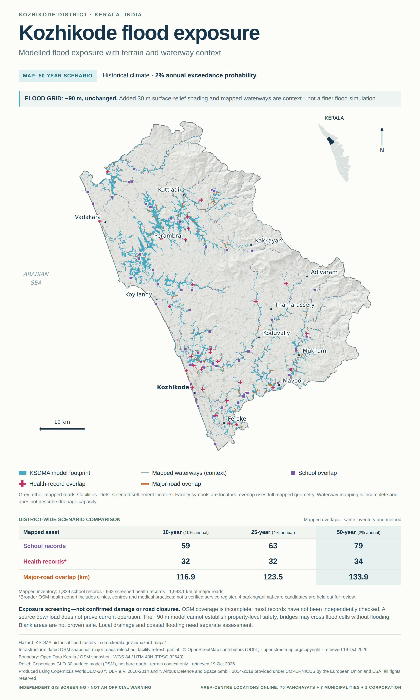

# Kozhikode Flood Atlas

A simple way to explore where KSDMA flood scenarios overlap mapped schools, health records and major roads in Kozhikode district.

[Open the map](https://kozhikode-flood-exposure.western-drifter.workers.dev)

The map is a first-pass exposure screen, not a forecast or a property-safety check. The official flood grid is about 90 m. Finer surface relief and waterway lines help you read the landscape; they do not improve the flood simulation.



## What you can explore

Switch between the 10-, 25- and 50-year scenarios. Show different map layers, filter health records by their OSM type, choose a local body, or download the tables. Display filters do not change the exposure totals.

The point layer covers the 70 gram panchayat areas, seven municipalities and one corporation in the boundary snapshot. These are approximate area centres—not offices, entrances, shelters or flood-safe points.

## Current results

| Scenario | School overlaps | Health-record overlaps | Major-road overlap, km |
|---|---:|---:|---:|
| 10-year | 59 | 32 | 116.9 |
| 25-year | 63 | 32 | 123.5 |
| 50-year | 79 | 34 | 133.9 |

These are mapped-record counts and geometric road intersections, not counts of damaged or operating facilities. The broader health cohort contains 662 records: 437 hospital-tag-class records, 173 clinics, 28 centres, 12 medical practices and 12 rehabilitation records. Types follow OSM tags and have not been independently verified as clinical classifications.

**The health count has changed scope.** It includes more than the earlier hospital-tag-only version, so the two totals are not directly comparable. Most records are not independently checked. In a small nine-record identity sample, six matched official sources and three remained unresolved; this does not validate coordinates or operation. Four parking/animal-care candidates are held out for review.

School and healthcare-tag snapshots were refreshed. Sixty-one health records retain the earlier hospital-tag snapshot because the wider amenity query failed. Amenity-only clinic/practice records may be missing. The major-road refresh succeeded, but the full-road query and fallback download did not. Existing waterway context is retained. Nothing here is a complete official infrastructure register.

[Read the inventory review](docs/inventory-review.md) and [source notes](docs/data-sources.md).

## Run it locally

No build step or framework is needed. From this folder:

```sh
python3 -m http.server 8000 --directory site
```

Open `http://localhost:8000`. Run the data checks with:

```sh
python3 -m unittest discover -s tests -v
node --check site/app.js
```

Processing scripts need their documented source data; original KSDMA rasters and raw OSM responses are not included. [Processing notes](docs/processing.md) explain the inputs. Legacy `hospitals_*` JSON keys carry the broader health-record cohort for compatibility; CSV downloads use `health_records_*` headers.

## Credits and reuse

The source data comes from KSDMA, OpenStreetMap contributors, Open Data Kerala and Copernicus DEM. The interface uses Leaflet and Public Sans. Required source, library and font credits are retained in [third-party notices](THIRD_PARTY_NOTICES.md). The code licence does not relicense third-party data. No Google Maps listing content or geometry is used.

## Owner and maintainer

[mhdejas](https://github.com/mhdejas)
